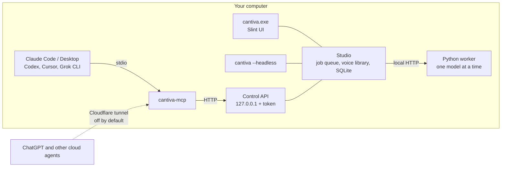

<div align="center">


<br>

[Architecture](docs/architecture.md) · [Changelog](CHANGELOG.md) · [Issues](https://github.com/naritaroad/cantiva/issues) · [Security](SECURITY.md)

[](https://github.com/naritaroad/cantiva/actions/workflows/ci.yml)


[](LICENSE)

**English** | [繁體中文](README.zh-TW.md)

</div>

---

Cantiva is a Windows desktop app for making speech with open-source TTS models on your own GPU. You write a script, Cantiva synthesizes each line with the voice you picked, lays the clips out on a multi-track timeline, and exports one WAV. The same functions are available to Claude, Codex, Cursor and Grok through an MCP server, so an agent can produce narration or a radio drama on your machine.

Models, voices and audio stay on your computer. The layout follows DaVinci Resolve's page bar and dark panels. The interface text is in Traditional Chinese (Taiwan).

## Features

- **Five engines, one in VRAM at a time.** Qwen3-TTS, GPT-SoVITS (v2ProPlus), Fun-CosyVoice 3, IndexTTS 2.5 and BreezyVoice. Each runs in its own Python virtualenv, so their dependencies never conflict. Switching engines unloads the previous one.
- **Script-driven, multi-voice synthesis.** Write `@Voice：{tone}line`, one paragraph per clip. Clips land on the timeline in script order.
- **Timeline and inspector.** One track per voice, waveforms, reordering, regenerating a single clip, stars and a level meter.
- **Voice library with consent records.** Clone a voice from a 3–15 s reference clip (3–10 s for GPT-SoVITS), or import a trained GPT-SoVITS character model (`.ckpt` + `.pth`). Every cloned voice needs a consent basis and a written statement.
- **Export.** Joins the timeline into one WAV, unifies sample rates across engines and normalizes loudness to EBU R128 (−16 LUFS by default).
- **MCP server.** `cantiva-mcp` exposes 10 tools, including `speak`, `render_script`, `list_voices` and `create_voice`, over stdio or Streamable HTTP. If Cantiva isn't running, it starts it headless.
- **Tunnel, off by default.** A Cloudflare quick tunnel lets cloud agents such as ChatGPT reach the MCP server. The URL carries a one-time secret, and tunnel requests get a reduced tool set.
- **Companion skill.** [`skill/cantiva-voice`](skill/cantiva-voice/SKILL.md) tells agents how to pick an engine, write scripts and handle consent.

## Screenshots


<details>
<summary>Other pages</summary>


</details>

The screenshots come from the built-in development engine, which generates synthetic syllables instead of speech.

## Architecture



Rust handles the UI, audio processing, job scheduling and MCP. Python only calls the models: each engine runs in its own worker process and talks to Cantiva over HTTP bound to 127.0.0.1. [docs/architecture.md](docs/architecture.md) covers the request flow, the worker protocol, the tunnel's security model and why each technology was chosen.

<details>
<summary>Engines</summary>

| Engine | Good at | VRAM | License |
|---|---|---|---|
| Qwen3-TTS | 9 built-in voices, tone set in natural language | ~7 GB (1.7B) | Apache-2.0 |
| GPT-SoVITS v2ProPlus | Japanese, character models, 3–10 s cloning | ~4 GB | MIT |
| Fun-CosyVoice 3 | Cross-lingual cloning, Chinese dialects | ~5 GB | Apache-2.0 |
| IndexTTS 2.5 | Emotion control (text or an 8-value vector) | ~6 GB | bilibili model license |
| BreezyVoice | Taiwanese Mandarin, Zhuyin fixes for polyphones | ~4 GB | Apache-2.0 |

VRAM figures are estimates from official material and parameter counts; the Engines page shows actual usage. Per-engine capabilities are listed in [skill/cantiva-voice/reference/engines.md](skill/cantiva-voice/reference/engines.md).

</details>

<details>
<summary>Where data lives</summary>

| Content | Location |
|---|---|
| Settings, database, logs | `%USERPROFILE%\Cantiva` |
| Engine virtualenvs and weights | `…\Cantiva\engines\<engine>` |
| Synthesized audio | `…\Cantiva\takes\<project>` (configurable) |
| Reference clips and character models | `…\Cantiva\references` |

Set `CANTIVA_HOME` to move the whole folder. Cantiva avoids `%APPDATA%` because processes started from MSIX-packaged apps such as Claude Desktop have their AppData writes redirected to a private folder that Cantiva can't see.

</details>

<details>
<summary>Script format</summary>

```text
# Scene 1
@旁白：{低沉、緩慢}夜深了，港口只剩下最後一盞燈。

@qwen3-tts/Serena：你還在等那艘船嗎？
```

- A blank line ends a clip.
- `@Name：` (or `@Name:`) picks a library voice or a built-in `engine/speaker`.
- `{…}` right after the tag is a tone instruction for engines that support it.
- Lines starting with `#` are comments.

Full rules: [skill/cantiva-voice/reference/script-format.md](skill/cantiva-voice/reference/script-format.md).

</details>

## Installation

Requires Windows 10/11 (x64) and an NVIDIA GPU (8 GB VRAM or more recommended).

### Download

Get the latest files from [Releases](https://github.com/naritaroad/cantiva/releases/latest):

| File | Use |
|---|---|
| `Cantiva-<version>-windows-x64-setup.exe` | Installer. Installs to `%LOCALAPPDATA%\Programs\Cantiva` without administrator rights, adds a Start-menu shortcut, and can install the agent skill and the tools engines need (uv, Git) with winget. |
| `Cantiva-<version>-windows-x64-portable.zip` | The same files without an installer. Unzip anywhere and run `cantiva.exe`. |
| `cantiva-voice-skill-<version>.zip` | The agent skill on its own. Unzip into `%USERPROFILE%\.claude\skills` or `%USERPROFILE%\.agents\skills`, or upload the zip in Claude's Skills settings. |
| `SHA256SUMS.txt` | Checksums. |

The binaries are not code-signed yet, so SmartScreen may warn on first run (More info, then Run anyway). Uninstalling removes the program files only; your data in `%USERPROFILE%\Cantiva` stays.

GPT-SoVITS also needs CMake and a C++ compiler. Run this from the Cantiva folder to install them:

```powershell
powershell -ExecutionPolicy Bypass -File scripts\install-tools.ps1 -GptSovits
```

### Build from source

From the repository root:

```powershell
powershell -ExecutionPolicy Bypass -File scripts\setup.ps1
```

`setup.ps1` uses winget to install whatever is missing (Git, Rust, Visual Studio Build Tools, uv, CMake, cloudflared), builds a release into `dist\Cantiva` and creates a Start-menu shortcut. Re-running it updates an existing install.

### After installing

1. Open Cantiva and install engines from the 引擎 (Engines) page. Each engine downloads several GB in its own PowerShell window and runs a self-test at the end.
2. Register the MCP server with your agents. The script is in the `scripts` folder of the install (or of the repository). Without switches it only prints the configuration and changes nothing.

   ```powershell
   powershell -ExecutionPolicy Bypass -File scripts\register-mcp.ps1 -Claude -Codex -Cursor -Grok -Skill
   ```

   For Claude Desktop, add the entry printed by `cantiva-mcp --print-config` by hand and restart the app.

## Project structure

```
cantiva/
├── app/                 Desktop app (Slint UI, playback, tunnel)
│   ├── ui/              .slint files
│   └── src/gui/         UI controller
├── mcp/                 cantiva-mcp (rmcp)
├── crates/
│   ├── cantiva-core/    Models, SQLite store, script parsing, settings, path safety
│   ├── cantiva-audio/   WAV I/O, concat, resample, loudness, peaks
│   ├── cantiva-engine/  Engine catalog, worker supervisor, Studio
│   └── cantiva-api/     Local control API and client
├── engines/             Per-engine adapter.py, engine.toml, install.ps1
│   └── _worker/         Shared Python worker (stdlib only)
├── skill/cantiva-voice/ Companion skill for agents
├── scripts/             setup, package, register-mcp, install-engine, install-tools
├── packaging/           Inno Setup installer script
├── tests/               End-to-end tests and the screenshot script
└── docs/                Architecture notes, zh-TW translations, assets
```

## Voices and licensing

Clone only your own voice, voices of people who have given you permission, or licensed material. Cantiva ships no voices of real people or characters. Each model and its pretrained weights carry their own license; IndexTTS 2.5 in particular restricts large commercial users. See [THIRD_PARTY_NOTICES.md](THIRD_PARTY_NOTICES.md).

## Contributing

Bug reports and pull requests are welcome. Read [CONTRIBUTING.md](CONTRIBUTING.md) for the build, the test commands and the project rules (one GPU model at a time, mandatory consent for cloned voices, local-only services). The `dev-sine` engine lets you run the whole pipeline without a GPU.

Report security issues privately as described in [SECURITY.md](SECURITY.md).

## License

MIT, see [LICENSE](LICENSE). The UI uses Slint under its Royalty-free License 2.0, and the About window shows the Slint attribution that license requires.
