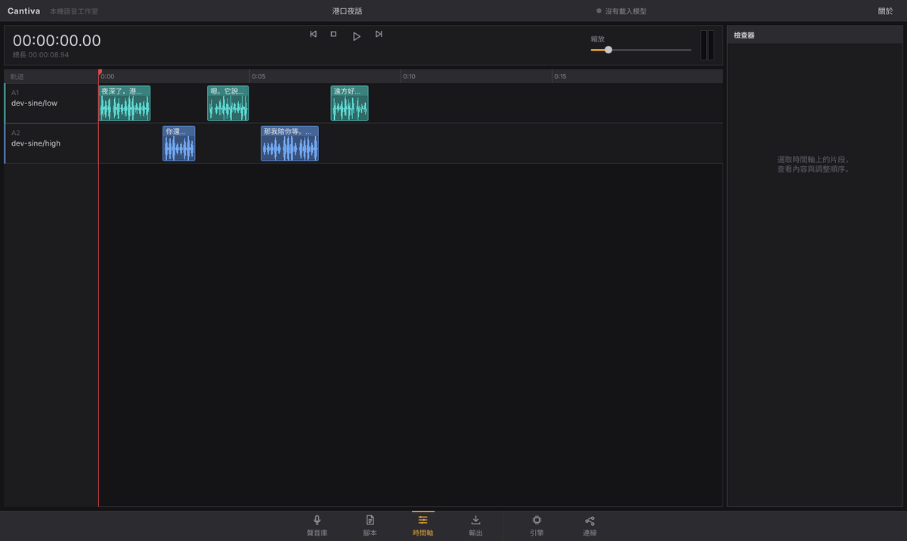
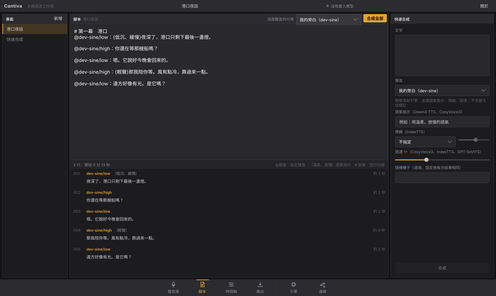
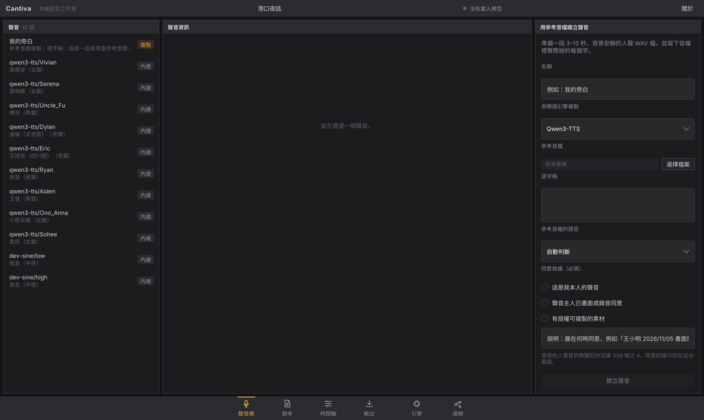
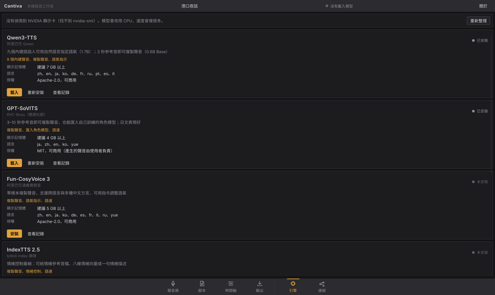
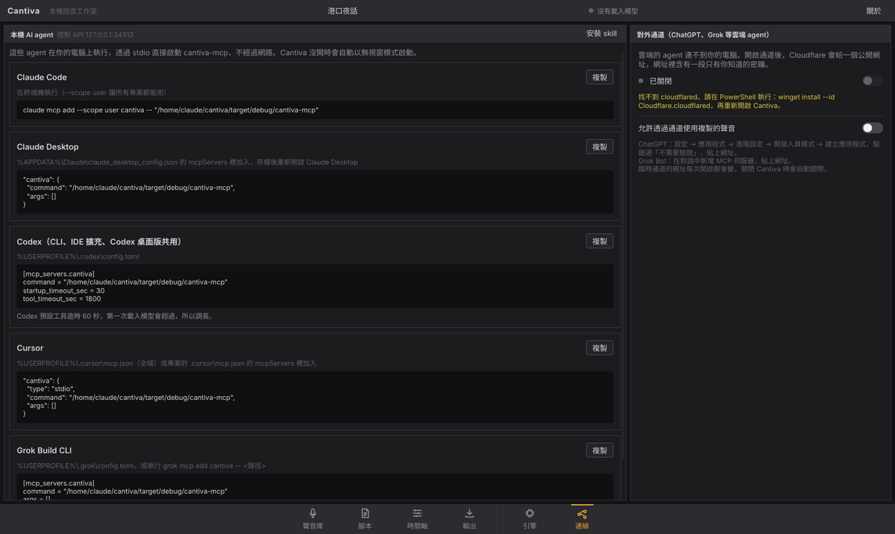
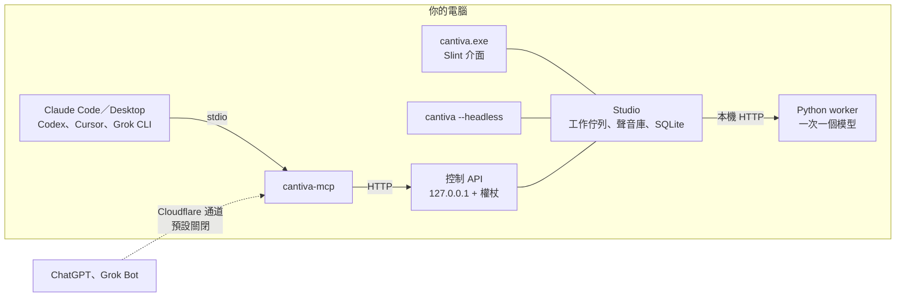

<div align="center">
  
  <h1>Cantiva</h1>
  <strong>本機語音工作室：開源 TTS 模型、剪輯式時間軸，以及給 AI agent 用的 MCP server</strong><br>
  模型、聲音與音檔都留在這台電腦。
</div>

<div align="center">


**繁體中文** | [English](docs/README.en.md)

</div>

---

Cantiva 是 Windows 桌面程式，介面參考 DaVinci Resolve 的剪輯軟體配置。它在你的顯示卡上跑五個開源 TTS 模型，把台詞合成在多軌時間軸上，再匯出成一個 WAV。同一套功能也透過 MCP 提供給 Claude、Codex、Cursor 與 Grok 使用。

## 功能

- **五個模型，一次只佔一個的顯示記憶體**：Qwen3-TTS、GPT-SoVITS（v2ProPlus）、Fun-CosyVoice 3、IndexTTS 2.5、BreezyVoice。每個模型有獨立的 Python 虛擬環境，套件版本互不衝突；換模型時自動卸載前一個。
- **腳本式多角色合成**：用 `@聲音：{語氣}台詞` 的格式寫腳本，一行一個片段，依序排上時間軸。
- **時間軸與檢查器**：每個聲音一條軌道，片段帶波形；可以調整順序、重新合成單一片段、標星號，並用音量表監聽。
- **聲音庫與同意紀錄**：用 3–15 秒參考音檔複製聲音（GPT-SoVITS 為 3–10 秒），或匯入自己訓練的 GPT-SoVITS 角色模型（`.ckpt` 加 `.pth`）。建立時必須選擇同意依據並寫下說明。
- **輸出**：依時間軸順序接成一個 WAV，自動統一不同模型的取樣率，並依 EBU R128 做響度正規化（預設 −16 LUFS）。
- **MCP server**：`cantiva-mcp` 提供 10 個工具，例如 `speak`、`render_script`、`list_voices`、`create_voice`。本機 agent 走 stdio；Cantiva 沒開時會自動以無視窗模式啟動。
- **對外通道（預設關閉）**：在「連線」頁開啟後，透過 Cloudflare 臨時通道讓 ChatGPT、Grok Bot 等雲端 agent 連線。網址帶有密鑰，工具權限會縮小。
- **配套 skill**：`skill/cantiva-voice` 告訴 agent 怎麼挑模型、寫腳本、處理同意紀錄。

## 畫面



<details>
<summary>其他頁面</summary>






</details>

截圖是用內建的開發測試引擎產生的（波形是模擬音節，不是真的語音）。

## 架構



Rust 負責介面、音訊處理、工作排程與 MCP；Python 只負責呼叫模型。每個模型跑在自己的 worker 程序裡，透過只綁 127.0.0.1 的 HTTP 協定溝通。完整說明與技術選擇的評估見 [docs/architecture.md](docs/architecture.md)。

<details>
<summary>引擎一覽</summary>

| 引擎 | 擅長 | 顯示記憶體 | 授權 |
|---|---|---|---|
| Qwen3-TTS | 9 個內建聲音、用自然語言指定語氣 | 約 7 GB（1.7B） | Apache-2.0 |
| GPT-SoVITS v2ProPlus | 日文、角色模型、3–10 秒複製 | 約 4 GB | MIT |
| Fun-CosyVoice 3 | 跨語言複製、中文方言 | 約 5 GB | Apache-2.0 |
| IndexTTS 2.5 | 情緒控制（文字或八維向量） | 約 6 GB | bilibili 模型協議 |
| BreezyVoice | 台灣華語、注音標破音字 | 約 4 GB | Apache-2.0 |

顯示記憶體是依官方資料與參數量估計，實際用量以「引擎」頁顯示為準。

</details>

<details>
<summary>資料放在哪裡</summary>

| 內容 | 位置 |
|---|---|
| 設定、資料庫、記錄檔 | `%APPDATA%\Naritaroad\Cantiva\data` |
| 各模型的虛擬環境與權重 | `…\data\engines\<引擎>` |
| 合成的音檔 | `…\data\takes\<專案>`（可在設定中修改） |
| 參考音檔與角色模型 | `…\data\references` |

設定環境變數 `CANTIVA_HOME` 可以把整個資料夾搬到別處。

</details>

## 安裝

需要 Windows 10/11 與 NVIDIA 顯示卡（建議 8 GB 以上）。在專案根目錄開 PowerShell：

```powershell
powershell -ExecutionPolicy Bypass -File scripts\setup.ps1
```

腳本會用 winget 補齊 Git、Rust、Visual Studio Build Tools、uv、CMake 與 cloudflared，接著編譯並建立開始功能表捷徑。之後的步驟：

1. 開啟 Cantiva，到「引擎」頁按「安裝」。每個模型會開一個 PowerShell 視窗下載，需要幾 GB 空間。
2. 註冊給 AI agent 使用（不加參數就只印出設定、不改任何檔案）：

```powershell
powershell -ExecutionPolicy Bypass -File scripts\register-mcp.ps1 -Claude -Codex -Cursor -Grok -Skill
```

## 專案結構

```
cantiva/
├── app/                 桌面程式（Slint 介面、播放、通道）
│   ├── ui/              .slint 介面檔
│   └── src/gui/         介面控制器
├── mcp/                 cantiva-mcp（rmcp）
├── crates/
│   ├── cantiva-core/    資料模型、SQLite、腳本解析、設定
│   ├── cantiva-audio/   WAV、合併、重新取樣、響度
│   ├── cantiva-engine/  模型目錄、worker 管理、Studio
│   └── cantiva-api/     本機控制 API 與客戶端
├── engines/             各模型的 adapter、描述檔與安裝腳本
│   └── _worker/         共用的 Python worker（只用標準函式庫）
├── skill/cantiva-voice/ 給 agent 的配套 skill
├── scripts/             setup、register-mcp、install-engine
├── tests/               端到端測試與截圖腳本
└── docs/
```

## 聲音與授權

複製聲音只用在你本人、已取得同意的人，或有授權的素材。各模型與預訓練權重有自己的授權，見 [THIRD_PARTY_NOTICES.md](THIRD_PARTY_NOTICES.md)。

## 開發

```bash
cargo test --workspace                      # Rust 單元與整合測試（含假引擎的完整流程）
python -m unittest discover engines/_worker/tests
python tests/e2e_mcp.py                     # 模擬 agent 呼叫 MCP 的端到端測試（Linux／macOS）
```

修改前請先讀 [AGENTS.md](AGENTS.md)，變更記錄在 [CHANGELOG.md](CHANGELOG.md)。

## 授權

MIT，見 [LICENSE](LICENSE)。介面使用 Slint 的免版稅授權，「關於」視窗依授權條款顯示 Slint 標示。
