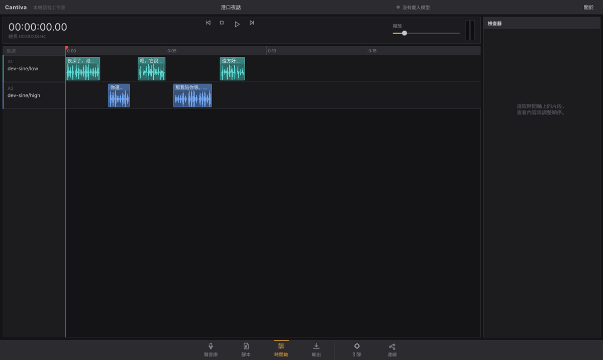

<div align="center">
  
  <h1>Cantiva</h1>
  <strong>A local voice studio: open-source TTS models, an editor-style timeline, and an MCP server for AI agents</strong><br>
  Models, voices and audio stay on your computer.
</div>

<div align="center">

[繁體中文](../README.md) | **English**

</div>

---

Cantiva is a Windows desktop app with a layout modelled on DaVinci Resolve. It runs five open-source TTS models on your GPU, lays synthesized lines out on a multi-track timeline, and exports one WAV. The same functions are exposed to Claude, Codex, Cursor and Grok through MCP.

The interface is in Traditional Chinese (Taiwan).

## Features

- **Five engines, one in VRAM at a time**: Qwen3-TTS, GPT-SoVITS (v2ProPlus), Fun-CosyVoice 3, IndexTTS 2.5 and BreezyVoice. Each runs in its own Python virtualenv, so their dependencies never conflict. Switching engines unloads the previous one.
- **Script-driven multi-voice synthesis**: write `@Voice：{tone}line`. Each paragraph becomes one clip, placed on the timeline in order.
- **Timeline and inspector**: one track per voice, waveforms, reordering, regenerating a single clip, stars, and a level meter.
- **Voice library with consent records**:
  - Clone a voice from a 3–15 s reference clip (3–10 s for GPT-SoVITS).
  - Import your own trained GPT-SoVITS character model (`.ckpt` + `.pth`).
  - A consent basis and statement are required.
- **Export**: joins the timeline into one WAV, unifies sample rates across engines, and normalizes loudness to EBU R128 (−16 LUFS by default).
- **MCP server**: `cantiva-mcp` provides 10 tools (`speak`, `render_script`, `list_voices`, `create_voice` and more) over stdio. It starts Cantiva headless when the app isn't open.
- **Tunnel (off by default)**: a Cloudflare quick tunnel for cloud agents such as ChatGPT and Grok Bot. The URL carries a secret, and tunnel requests get reduced tool permissions.
- **Companion skill**: `skill/cantiva-voice` teaches agents how to pick an engine, write scripts and handle consent.

## Screenshot



The screenshots use the built-in development engine, which generates synthetic syllables rather than real speech.

## Install

Requires Windows 10/11 and an NVIDIA GPU (8 GB+ recommended). From the repository root:

```powershell
powershell -ExecutionPolicy Bypass -File scripts\setup.ps1
```

`setup.ps1` installs missing tools with winget (Git, Rust, VS Build Tools, uv, CMake, cloudflared), builds a release, and creates a Start-menu shortcut.

After that:

1. Open Cantiva and install engines from the 引擎 (Engines) page.
2. Register the MCP server with your agents:

   ```powershell
   powershell -ExecutionPolicy Bypass -File scripts\register-mcp.ps1 -Claude -Codex -Cursor -Grok -Skill
   ```

## More

- Architecture and technology evaluations: [architecture.md](architecture.md)
- Model licenses: [THIRD_PARTY_NOTICES.md](../THIRD_PARTY_NOTICES.md)
- Changes: [CHANGELOG.md](../CHANGELOG.md)

## License

MIT, see [LICENSE](../LICENSE). The UI uses Slint under its Royalty-free License; the About window shows the Slint attribution as that license requires.
